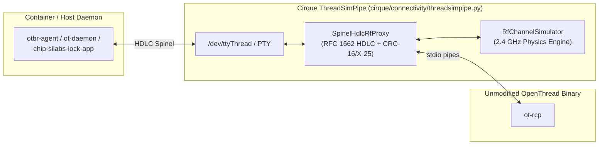

# Cirque 2.4 GHz Multi-Radio RF Channel & Coexistence Simulation Design

> [!IMPORTANT]
> **Related Design Documents**:
> - [Unified Virtual RF Architecture (`docs/VIRTUAL_RF_ARCHITECTURE.md`)](./VIRTUAL_RF_ARCHITECTURE.md)
> - [Virtual Bluetooth Design (`docs/VIRTUAL_BT_DESIGN.md`)](./VIRTUAL_BT_DESIGN.md)
> - [Virtual Wi-Fi Design (`docs/VIRTUAL_WIFI_DESIGN.md`)](./VIRTUAL_WIFI_DESIGN.md)

---

## 1. Overview & Motivation

By default, virtualized smart-home testbeds operate in an **idealized (`0%` loss, constant RSSI)** radio regime where every BLE advertisement, Wi-Fi L2 frame, and IEEE 802.15.4 Thread packet is delivered instantaneously with deterministic signal strength (`-38` to `-44 dBm`, `LQI = 255`, `PER = 0.0`). While effective for happy-path functional smoke tests, this ideal environment masks timing-sensitive protocol bugs, exchange-pool exhaustion, asymmetric link traps, and retransmission race conditions in upper-layer stacks such as Matter (`connectedhomeip`) and OpenThread.

`RfChannelSimulator` (`cirque/connectivity/rf_channel_simulator.py`) and `SpinelHdlcRfProxy` (`cirque/connectivity/threadsimpipe.py`) introduce a unified, literature-grounded **2.400–2.4835 GHz ISM Multi-Radio RF Channel & Coexistence Simulator** across all three virtual radios in Cirque—**Bluetooth Low Energy (BLE)**, **IEEE 802.11 (Wi-Fi)**, and **IEEE 802.15.4 (Thread)**—entirely within Cirque userspace and **with zero modifications to the OpenThread or Matter C++ codebases**.

---

## 2. Five-Stage 2.4 GHz Physical Layer & Coexistence Model

Every packet traversing `LinkLayerHub` (BLE), `VirtualWiFiServer` (Wi-Fi), or `SpinelHdlcRfProxy` (Thread 802.15.4) is evaluated through a five-stage stochastic physical model in `RfChannelSimulator.evaluate_packet()`:

### Stage 1: Log-Distance Path Loss with Multi-Wall Attenuation (Keenan–Motley Model)

$$PL(d) = PL(d_0) + 10 \, n \, \log_{10}\!\left(\frac{\max(d, d_{\min})}{d_0}\right) + \sum_{k} W_k$$

where $PL(d_0) = 20 \log_{10}(f_{\text{MHz}}) - 27.55$ is the Friis free-space reference path loss at $d_0 = 1.0\text{ m}$ (`~40.05 dB` at `2.44 GHz`), $n$ is the path-loss exponent (`2.0` LoS to `3.2+` obstructed indoor), and $\sum_k W_k$ is the cumulative drywall/masonry partition attenuation (`dB`).

- **External References**:
  - J. M. Keenan and A. J. Motley, *"Radio coverage in buildings,"* British Telecom Technology Journal, vol. 8, no. 1, pp. 19–24, Jan. 1990.
  - T. S. Rappaport, *Wireless Communications: Principles and Practice*, 2nd ed., Prentice Hall, 2002, ch. 4, eq. (4.68)–(4.71).
  - ITU-R Recommendation P.1238-11, *"Propagation data and prediction methods for the planning of indoor radiocommunication systems and radio local area networks in the frequency range 300 MHz to 450 GHz,"* 2021.

### Stage 2: Gudmundson First-Order Autoregressive `AR(1)` Temporally Correlated Log-Normal Shadowing

$$X_{ij}(t) = \rho \, X_{ij}(t - \Delta t) + \sqrt{1 - \rho^2} \, \sigma_s \, \mathcal{N}(0, 1)$$

where $\sigma_s$ (`shadowing_sigma_db`) is the log-normal shadowing standard deviation (`dB`) and $\rho \in [0, 1)$ (`shadowing_correlation_rho`) is the lag-1 temporal correlation coefficient governing whether fades occur as isolated packet drops ($\rho \to 0$) or prolonged multi-second human-body blockage troughs ($\rho \ge 0.90$).

- **External References**:
  - M. Gudmundson, *"Correlation model for shadow fading in mobile radio systems,"* Electronics Letters, vol. 27, no. 23, pp. 2145–2146, Nov. 1991.
  - 3GPP TR 38.901, *"Study on channel model for frequencies from 0.5 to 100 GHz,"* Section 7.4.4 (Autocorrelation of Shadowing).

### Stage 3: Unit-Mean Normalized Rician (LoS, $K > 0$) and Rayleigh (NLoS, $K = 0$) Multipath Fading

$$|h|^2 = \left(\sqrt{\frac{K}{K+1}} + \sqrt{\frac{1}{2(K+1)}} \, X\right)^{\!2} + \left(\sqrt{\frac{1}{2(K+1)}} \, Y\right)^{\!2}, \quad X, Y \sim \mathcal{N}(0, 1), \quad \mathbb{E}\!\left[|h|^2\right] = 1$$

When $K \to 0$ (`fading_mode='rayleigh'`), the line-of-sight specular component vanishes and $|h|^2 \sim \text{Exp}(1)$ follows Rayleigh envelope power fading with deep fade troughs (`-10` to `-25 dB`).

- **External References**:
  - S. O. Rice, *"Statistical properties of a sine wave plus random noise,"* Bell System Technical Journal, vol. 27, no. 1, pp. 109–157, Jan. 1948.
  - A. Goldsmith, *Wireless Communications*, Cambridge University Press, 2005, Section 3.2 (Narrowband Fading Models).

### Stage 4: Thermal Noise Floor and Cross-Protocol 2.4 GHz Spectral Overlap SINR

$$\text{SINR}_{\text{dB}} = P_{\text{rx,dBm}} - 10 \log_{10}\!\left(10^{N_{0,\text{dBm}}/10} + \sum_{k} \alpha_{ik} \, D_k \, I_{k,\text{mW}}\right)$$

where $\alpha_{ik} \in [0, 1]$ is the fractional power spectral density overlap (`spectral_overlap_factor()`) between victim channel $i$ ($[f_i - B_i/2, f_i + B_i/2]$) and interferer $k$ ($[f_k - B_k/2, f_k + B_k/2]$) across BLE (`2 MHz`), IEEE 802.15.4 Thread (`2 MHz`, channels `11..26` at $2405 + 5(c - 11)\text{ MHz}$), and IEEE 802.11 Wi-Fi (`20 MHz`, channels `1..13` at $2407 + 5c\text{ MHz}$), and $D_k \in [0, 1]$ is the interferer duty cycle.

- **External References**:
  - IEEE Std 802.15.2-2003, *"IEEE Recommended Practice for Information technology—Telecommunications and information exchange between systems—Local and metropolitan area networks—Specific requirements—Part 15.2: Coexistence of Wireless Personal Area Networks with Other Wireless Devices Operating in Unlicensed Frequency Bands,"* Clause 6 (Analytical Coexistence Model).
  - R. Natarajan, P. Zand, and M. Nabi, *"Analysis of coexistence between IEEE 802.15.4, BLE and IEEE 802.11 in the 2.4 GHz ISM band,"* in Proc. IEEE IECON, Oct. 2016, pp. 6025–6032.

### Stage 5: Modulation-Specific $\text{SINR} \to \text{BER} \to \text{PER}$ and IEEE 802.15.4 LQI Mapping

- **IEEE 802.15.4 O-QPSK DSSS (`250 kbps`, 16-ary quasi-orthogonal chip sequences, `ber_802154_oqpsk()`)**:
  Evaluates the exact IEEE Std 802.15.4-2020 Annex E.4.1.8 sum over $k = 2 \dots 16$ binomial terms, scaled by $0.85\times$ so the 1% PSDU PER cliff aligns with `-98 dBm` sensitivity at $N_0 = -95\text{ dBm}$.
- **BLE 1M GFSK (`ber_ble_gfsk()`)** & **IEEE 802.11g/n OFDM (`ber_wifi_ofdm()`)**:
  Complementary error-function $Q(\sqrt{\gamma})$ models matched to receiver sensitivity thresholds (`-96 dBm` BLE, `-88 dBm` Wi-Fi).
- **Packet Error Rate (`compute_per_from_ber()`)**:
  $$\text{PER}(L) = 1 - (1 - \text{BER})^{8L} = -\text{expm1}\!\left(8L \, \text{log1p}(-\text{BER})\right)$$
  using numerically stable `math.expm1` and `math.log1p` to avoid floating-point catastrophic cancellation at low BER.
- **IEEE 802.15.4 LQI (`0..255`) and OpenThread Link Quality (`0..3`)**:
  Blends receiver SINR sigmoid and RSSI margin (`compute_802154_lqi()`) and maps link margin to OpenThread `LQ In` $\in \{0, 1, 2, 3\}$ (`compute_openthread_link_quality()`).

- **External References**:
  - IEEE Std 802.15.4-2020, Annex E.4.1.8 (*"Bit errorier rate (BER) calculations for 2450 MHz O-QPSK PHY"*) and Clause 10.2.6 (*"Link quality indicator (LQI)"*).

---

## 3. Architecture: Zero-OpenThread-Change Interception via `SpinelHdlcRfProxy`

To simulate Thread 802.15.4 RF impairments **without modifying a single line of OpenThread C/C++ code**, Cirque intercepts the HDLC-framed Spinel stream between the host/container daemon (`otbr-agent`, `ot-daemon`, or `qemu-arm` Silabs Lock App) and the unmodified `ot-rcp` process inside `ThreadSimPipe` (`cirque/connectivity/threadsimpipe.py`).



### How `SpinelHdlcRfProxy` Rewrites Spinel Frames In-Flight

1. **Inbound RX Frames (`RCP -> Host`, `SPINEL_PROP_STREAM_RAW = 0x71`)**:
   - Unescapes the RFC 1662 HDLC frame (`0x7E` flag, `0x7D` escape, plus OpenThread POSIX `HdlcInterface::Write` special-escaped bytes `0x11`, `0x13`, `0xF8`).
   - Parses `PackRadioFrame` (`[psdu_len_lo, psdu_len_hi] + psdu + [rssi_int8, noise_floor_int8, flags(2B), phy_header(10B)]`).
   - Evaluates `RfChannelSimulator.evaluate_packet('thread', peer_id, node_id, frame_len_bytes=psdu_len)`.
   - If `sample.dropped` is `True` (and the frame is not an 802.15.4 Beacon `frame_type == 0` required for cold commissioning scan), drops the frame before it reaches `otbr-agent` / the end-device.
   - Otherwise, rewrites `rssi_int8 = sample.rssi_dbm`, `noise_floor_int8 = int(sample.noise_floor_dbm)`, and `lqi_uint8 = sample.lqi`, recomputes `CRC-16/X-25` (`poly=0x8408, init=0xFFFF, xorout=0xFFFF`), and re-encodes the HDLC frame.
2. **Inbound TX-Done ACK Metadata (`RCP -> Host`, `SPINEL_PROP_LAST_STATUS = 0x00`)**:
   - When an outbound data frame was marked as dropped by `RfChannelSimulator` (`_drop_next_tx_done`), rewrites `SPINEL_STATUS_OK (0x00)` to **`SPINEL_STATUS_NO_ACK (0x11)`** while preserving the `headerUpdated` boolean and the 5-byte `(keyIndex, frameCounter)` MAC security trailer appended by `ot-rcp`, causing the sender's OpenThread MAC layer to increment `TxRetry` / `TxErrNoAck` and perform genuine IEEE 802.15.4 CSMA/CA retransmissions (and any upper-layer retransmissions) without corrupting the auxiliary security frame counter!
   - When the ACK succeeds, rewrites the embedded ACK `PackRadioFrame` RSSI and LQI fields so `ot-ctl child table` and `ot-ctl neighbor table` reflect live link quality (`LQ In` $\in \{0, 1, 2, 3\}$).
3. **Ambient CCA Energy Queries (`RCP -> Host`, `SPINEL_PROP_PHY_RSSI = 0x26`)**:
   - Rewrites the 1-byte signed RSSI response to `ot-ctl rssi` and CSMA/CA Clear Channel Assessment using `RfChannelSimulator.sample_ambient_cca_rssi_dbm('thread')`.

---

## 4. Complete Catalog of the 9 Built-In Researcher RF Presets

Researchers can switch presets at any time via Python (`RfChannelSimulator.get_shared().apply_regime_preset(preset)`), Flask REST (`POST /rf_channel {"preset": "<name>"}`), or MCP (`cirque_inject_rf_fault`).

| Preset Name | Distance & Topology | Fading & Shadowing ($\sigma_s, \rho, K$) | Active 2.4 GHz Interferers | Typical Thread RSSI / SINR / LQI / Drop Rate | Target Research & Protocol Validation Goal |
| :--- | :--- | :--- | :--- | :--- | :--- |
| **`ideal`** *(Default)* | `d = 1.5 m`, `n = 2.0`, `0` walls | Disabled (`enabled=False`, `0.0 dB` jitter) | None | `-44.0 ± 0.0 dBm`, `SINR +51.0 dB`, `LQI 255.0`, `0.0%` drops | Deterministic happy-path baseline (`0` MAC retries). |
| **`regime_a_near_los`** | `d = 1.5 m`, `n = 2.0`, `0` walls | Rician $K = 12\text{ dB}$, $\sigma_s = 0.8\text{ dB}$, $\rho = 0.85$ | None | `-66.4 ± 2.7 dBm`, `SINR +28.6 dB`, `LQI 239.7`, `0.0%` drops | Same-room Line-of-Sight with realistic Rician micro-fading (`LQ = 3`). |
| **`regime_b_far_nlos_fading`** | `d = 15.0 m`, `n = 2.9`, `2` walls (`11 dB`) | Rayleigh ($K = 0$), $\sigma_s = 4.2\text{ dB}$, $\rho = 0.80$ | None | `-85.4 ± 7.3 dBm`, `SINR +6.6 dB`, `LQI 120.6`, `~9.3%` drops | Multi-room NLoS multipath fading with isolated single-frame drops. |
| **`regime_c_cochannel_interference`** | `d = 15.0 m`, `n = 2.9`, `2` walls (`11 dB`) | Rayleigh ($K = 0$), $\sigma_s = 4.2\text{ dB}$, $\rho = 0.80$ | Wi-Fi Ch 4 (`+20 dBm`, `75%`) + Wi-Fi Ch 6 (`+20 dBm`, `75%`) + BLE Ch 38 (`+10 dBm`, `60%`) | `-85.1 ± 7.1 dBm`, `SINR -38.5 dB`, `LQI 33.5`, `~40.4%` drops | Heavy 2.4 GHz Wi-Fi/BLE/Thread co-channel collision stress test. |
| **`regime_d_cell_edge_sensitivity`** | `d = 25.0 m`, `n = 3.2`, `3` walls (`16.5 dB`) | Rayleigh ($K = 0$), $\sigma_s = 2.0\text{ dB}$, $\rho = 0.85$ | None (thermal noise limited at `-95 dBm`) | `-94.5 ± 6.1 dBm`, `SINR +0.5 dB`, `LQI 60.6`, `~37.8%` drops | Receiver sensitivity cliff (`-95` to `-100 dBm`) and MTU frame-size survival testing. |
| **`regime_e_asymmetric_hidden_node`** | `d = 14.0 m`, `n = 2.8`, `1` wall; TBR `+20 dBm` vs SED `0 dBm` | Rayleigh ($K = 0$), $\sigma_s = 2.5\text{ dB}$, $\rho = 0.82$ | Near-TBR Wi-Fi Ch 4 jammer at `(0.6m, 0, 1m)`, `+20 dBm`, `80%` duty cycle | Downlink `SINR +18.9 dB` (`LQI 211`) vs Uplink `SINR -21.7 dB` (`LQI 87`) | Asymmetric link (`TBR -> SED` clean, `SED -> TBR` ACK/ReportData jammed). |
| **`regime_f_bursty_body_shadowing`** | `d = 12.0 m`, `n = 2.8`, `2` walls (`10 dB`) | Rayleigh ($K = 0$), **$\sigma_s = 7.5\text{ dB}$, $\rho = 0.95$** | None | `-85.3 ± 10.2 dBm`, `SINR +6.7 dB`, `LQI 120.5`, `~19.3%` burst drops | Temporally correlated human-body blockage causing bursts of consecutive drops that can exhaust upper-layer retransmission budgets. |
| **`regime_g_orthogonal_channel_agility`** | `d = 10.0 m`, `n = 2.6`, `1` wall; BLE Ch 39 (`2480 MHz`), Thread Ch 25 (`2475 MHz`) | Rician $K = 6\text{ dB}$, $\sigma_s = 2.0\text{ dB}$, $\rho = 0.80$ | Wi-Fi Ch 1 (`2412 MHz`, `+20 dBm`, `85%`) + Wi-Fi Ch 6 (`2437 MHz`, `+20 dBm`, `85%`) | `-84.0 ± 4.7 dBm`, `SINR +9.0 dB` ($\alpha_{ik} = 0$), `LQI 142.2`, `~1.8%` drops | Validates spectral orthogonality when migrating Thread to Ch 25/26 away from Wi-Fi Ch 1/6. |
| **`regime_h_microwave_broadband_jammer`** | `d = 9.0 m`, `n = 2.6`, `1` wall; Thread Ch 19 (`2445 MHz`) | Rayleigh ($K = 0$), $\sigma_s = 3.5\text{ dB}$, $\rho = 0.85$ | Domestic microwave magnetron (`2447 MHz` Ch 8, `20 MHz` BW, `+23 dBm`, `50%` duty cycle) | `-75.5 ± 6.7 dBm`, `SINR -27.4 dB`, `LQI 55.2`, `~41.2%` drops | Periodic `2.45 GHz` non-Wi-Fi broadband residential interference. |

### Custom Fine-Grained Researcher Configuration (`POST /rf_channel`)

Beyond the 9 named presets, researchers can configure arbitrary 3D node topologies, per-radio TX powers, wall counts, propagation constants, PRNG seeds, and multi-interferer scenarios in a single JSON payload:

```json
{
  "preset": "regime_b_far_nlos_fading",
  "seed": 2026,
  "config": {
    "path_loss_exp": 3.1,
    "wall_loss_db": 6.0,
    "shadowing_sigma_db": 5.5,
    "shadowing_correlation_rho": 0.92,
    "fading_mode": "rayleigh",
    "noise_floor_dbm": -93.0,
    "max_per_cap": 0.45,
    "ble_channel": 38,
    "wifi_channel": 6,
    "thread_channel": 15
  },
  "nodes": [
    {"node_id": "tbr", "x_m": 0.0, "y_m": 0.0, "z_m": 1.0, "tx_power_thread_dbm": 8.0, "walls": 1},
    {"node_id": "sed", "x_m": 16.0, "y_m": 2.5, "z_m": 1.0, "tx_power_thread_dbm": 0.0, "walls": 2}
  ],
  "interferers": [
    {"interferer_id": "neighbor_ap", "protocol": "wifi", "channel": 4, "tx_power_dbm": 18.0, "duty_cycle": 0.65, "x_m": 2.0, "y_m": 1.0, "z_m": 1.0}
  ]
}
```

---

## 5. Protocol-Level Race Conditions Exposed by RF Presets

A central question for protocol engineers is why replace the default `ideal` preset with presets like `regime_b_far_nlos_fading` or `regime_f_bursty_body_shadowing`.

Under `ideal` (`0%` packet loss, `0.0 dB` RSSI variance), frames succeed on the first transmission, hiding timing and concurrency races. Under non-ideal regimes, dropped frames trigger retries, backoffs, and timeouts, stretching exchange lifetimes and exposing state-machine race conditions.

For Matter (`connectedhomeip`) protocol-level tests that exercise packet loss, see `docs/testing/cirque_rf_lossy_link.md` in the `connectedhomeip` repository.

---

## 6. Verification Commands

```bash
# 1. Run the hermetic Cirque RF Channel Simulator & SpinelHdlcRfProxy unit test suite (11 tests):
PYTHONPATH=. python3 cirque/connectivity/test_rf_channel_simulator.py -v

# 2. Run the end-to-end Android Emulator + Thread Border Router + Silabs Lock App RF RSSI test:
python3 src/test_driver/linux-cirque/AndroidBleThreadSilabsLockRfRssiTest.py
```
